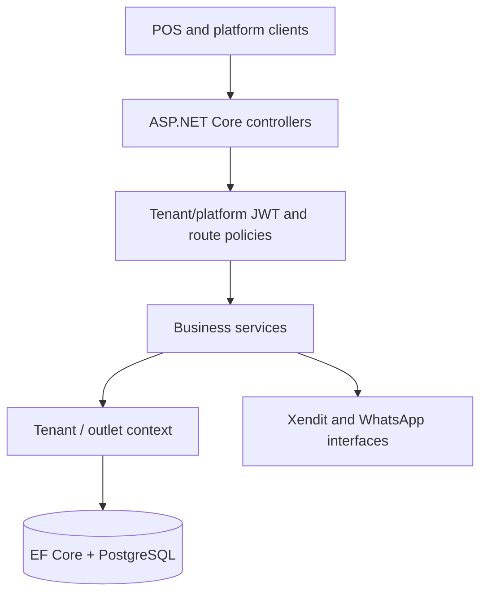
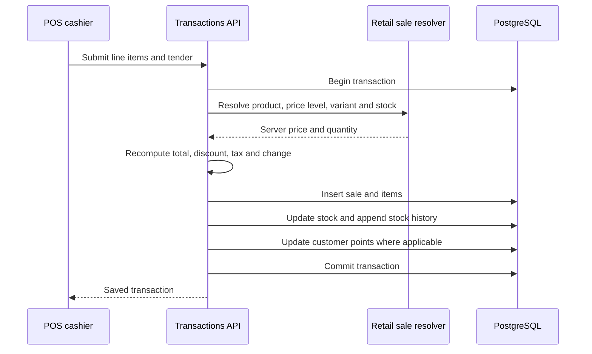

# Neverfade POS — architecture and consistency

## Major boundaries

The application is layered, not a distributed microservice architecture.
Controller boundaries call services; services use a shared `AppDbContext` and
provider abstractions where external systems are involved. Multi-tenancy is
enforced through authenticated tenant context, EF query filters and specific
outlet/object authorization paths. `PlatformJwt` is configured distinctly
from tenant JWT to isolate control-plane capabilities.

Source references:

- [`AppDbContext.cs`](../NeverfadePos.Api/Data/AppDbContext.cs)
- [`TenantMiddleware.cs`](../NeverfadePos.Api/Middleware/TenantMiddleware.cs)
- [`TenantExecutionContext.cs`](../NeverfadePos.Api/Auth/TenantExecutionContext.cs)
- [`RequireOutletScopeAttribute.cs`](../NeverfadePos.Api/Auth/RequireOutletScopeAttribute.cs)
- [`Program.cs`](../NeverfadePos.Api/Program.cs)

## Cash sale and inventory

`TransactionService.CreateAsync` rejects non-cash payment methods on the cash
endpoint, invalid totals, missing customer references and insufficient tender.
The submitted money fields are checked against recomputed values instead of
being trusted for persistence. The write includes transaction items, stock
movements and loyalty-point updates in one EF database transaction.

Payment-mode and Xendit paths are separate from this cash transaction path;
see [`PaymentService.cs`](../NeverfadePos.Api/Services/Payment/PaymentService.cs)
and [`XenditPaymentProvider.cs`](../NeverfadePos.Api/Payments/Xendit/XenditPaymentProvider.cs).

## Test boundaries and trade-offs

- API tests use xUnit, ASP.NET Core test infrastructure and EF InMemory for
  many scenarios. This does not prove every PostgreSQL transaction/race case.
- Outlet guards complement EF tenant filtering; adding new resources requires
  both tenant and outlet-level negative tests.
- Seed/bootstrap and EF migrations are intentionally operationally sensitive:
  run them only against an isolated database during verification.
- Historical QA and sprint evidence apply to their recorded branches/SHAs,
  not automatically to current `main` or a production deployment.
